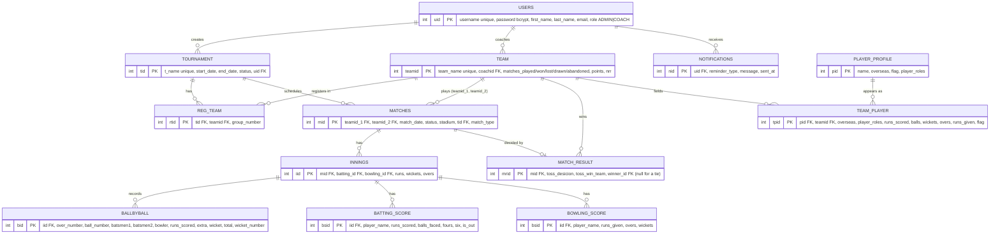

# CRICBEAR Backend

Spring Boot 3.3 (Java 22) microservices on Postgres. Back to the [root README](../README.md) · [Frontend README](../CRICBEAR_Frontend/README.md).

| Service | Port | Purpose |
|---|---|---|
| `userAuthorisation` | 8083 | Registration, login, user roles (bcrypt passwords, never returned by the API) |
| `tournament` | 8084 | Tournaments, teams, players, matches, scoring, standings |
| `notificationService` | 8081 | Scheduled reminders (optional) |
| `gateway` | 8080 | Spring Cloud Gateway (optional) |
| `eureka` | 8761 | Service registry (optional) |

The dashboards call `userAuthorisation` and `tournament` directly. The other three are optional.

## Architecture

```
HTTP ─► controller (REST, CORS) ─► service (rules: scheduling, standings, scoring)
                                      └─► repository (Spring Data JPA) ─► Postgres
```

Each service is a separate Maven project: `<service>/src/main/java/.../{controller,service,repository,model,config}`. Enums are stored as strings (`@Enumerated(EnumType.STRING)`). There is no `ddl-auto`: [`DB_SETUP/schema.sql`](DB_SETUP/schema.sql) is the source of truth and must match the entities.

### Match lifecycle

1. An admin creates a tournament (`UPCOMING`) and coaches register teams (`reg_team`, split into groups).
2. `POST /tournament/start` starts it; `GET /match/schedule/{tid}/{uid}` creates the `NORMAL` group matches.
3. `GET /match/start/{mid}` works on the match date: the match becomes `LIVE`, innings are created, and the engine writes ball-by-ball, batting and bowling rows while it plays.
4. When the second innings ends, a `match_result` row is written and team points and net run rate are updated (2 points for a win, 1 each for a tie).
5. `GET /match/semi/{tid}/{uid}` and `GET /match/final/{tid}/{uid}` create the `SEMIFINAL` and `FINAL` matches from the points table.

## Data model



Enumerations (stored as `VARCHAR`):

| Field | Values |
|---|---|
| `users.role` | `ADMIN`, `COACH` |
| `tournament.status`, `matches.status` | `LIVE`, `UPCOMING`, `COMPLETED` |
| `matches.match_type` | `NORMAL`, `SEMIFINAL`, `FINAL` |
| `ballbyball.extra` | `WIDE`, `NOBALL` |
| `ballbyball.wicket` | `CAUGHT`, `BOWLED`, `RUNOUT`, `LBW` |
| `match_result.toss_desicion` | `BAT`, `BOWL` |
| `*.player_roles` | `BATSMAN`, `BOWLER`, `WICKETKEEPER`, `ALLROUNDER` |

Delete rules: removing a user cascades to their tournaments, teams and notifications; removing a tournament sets `matches.tid` to null; removing a team cascades to its registrations, matches, innings and players. The column `toss_desicion` (sic) matches the `MatchResult` entity.

## REST API

### userAuthorisation (`/user`)
`GET /all` · `GET /{uid}` · `POST /register` · `POST /login` · `POST /getRole` · `PUT /setUserRole/{uid}`

### tournament
| Prefix | Endpoints |
|---|---|
| `/tournament` | `POST /create`, `PUT /update/{uid}`, `GET /getById/{id}`, `GET /getAll`, `DELETE /delete/{id}`, `POST /getByStatus`, `POST /start`, `GET /getByTid/{tid}` |
| `/team` | `POST /create`, `PUT /update`, `GET /getAll`, `GET /getByID/{id}`, `GET /getByName/{name}`, `GET /getTeamId/{coachid}`, `GET /findInDesc` (points table), `DELETE /delete/{id}` |
| `/player` | `POST /create`, `PUT /update`, `GET /getAll`, `DELETE /delete/{name}` |
| `/playerTeams` | `GET /all`, `GET /{tpid}`, `GET /team/{teamId}`, `GET /count/team/{id}`, `POST /addPlayerTeam`, `DELETE /delete/{pid}` |
| `/regTeam` | `POST /addRegTeam`, `GET /getAll`, `DELETE /delete` |
| `/match` | `GET /schedule/{tid}/{uid}`, `GET /start/{mid}`, `GET /update/{mid}`, `GET /semi/{tid}/{uid}`, `GET /final/{tid}/{uid}`, `GET /status/{status}`, `GET /getByTid/{tid}` |
| `/matchResult` | `GET /all` (every finished match), `GET /getResultById/{mid}` |
| `/innings`, `/ballByBall`, `/battingScore`, `/bowlingScore` | `GET /{mid}` |

## Run

```bash
psql "$POSTGRES_URL" -f DB_SETUP/schema.sql
export DATABASE_URL='jdbc:postgresql://<host>/<db>?sslmode=require'
export DATABASE_USER='<user>' DATABASE_PASSWORD='<password>'
cd userAuthorisation && mvn spring-boot:run     # :8083
cd tournament && mvn spring-boot:run            # :8084
```

Tests: `mvn test` in each service. With JDK 23+ the poms set `<proc>full</proc>` so Lombok's annotation processor runs. Each of `userAuthorisation` and `tournament` has a `Dockerfile` (Maven build on JDK 22, run on a JRE).

## Configuration

| Variable | Purpose |
|---|---|
| `DATABASE_URL` / `DATABASE_USER` / `DATABASE_PASSWORD` | Postgres JDBC connection (required) |
| `PORT` | HTTP port (defaults 8083 / 8084) |
| `CORS_ORIGINS` | Comma-separated allowed browser origins (default `http://localhost:3000,http://localhost:3001`) |
