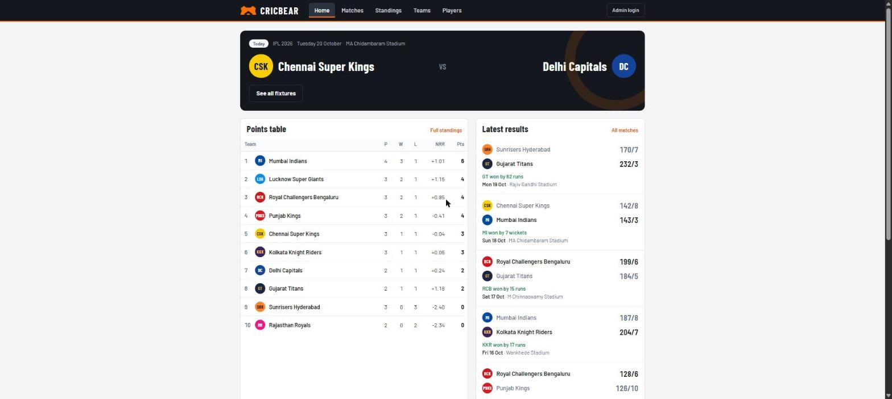
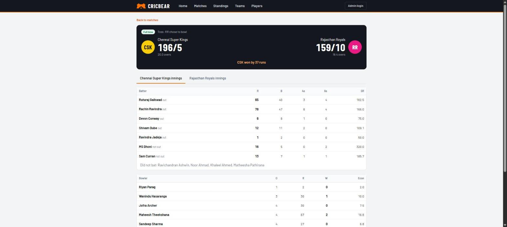
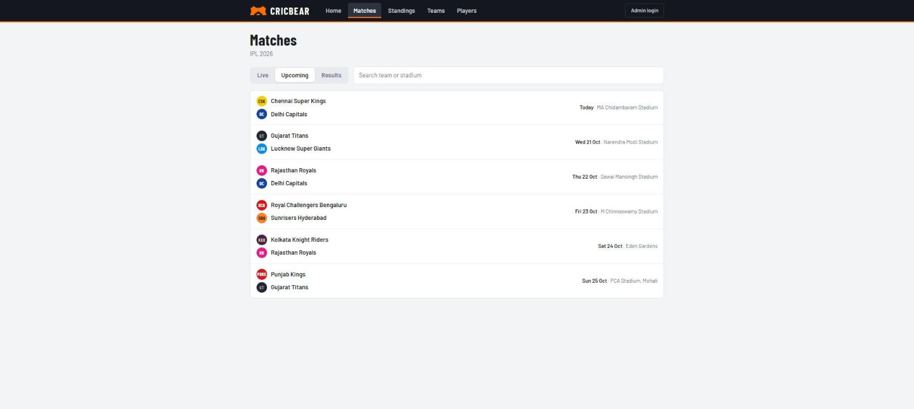
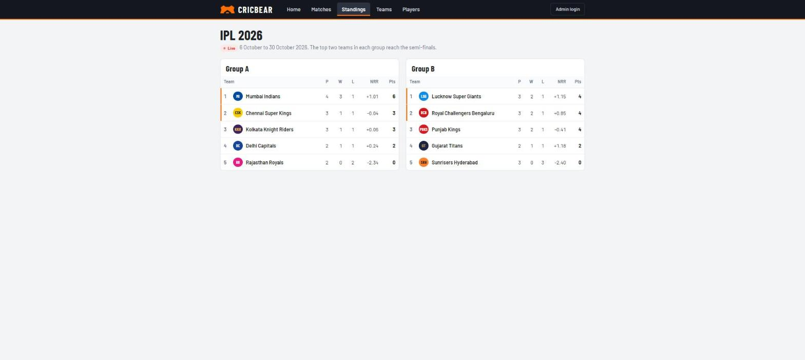
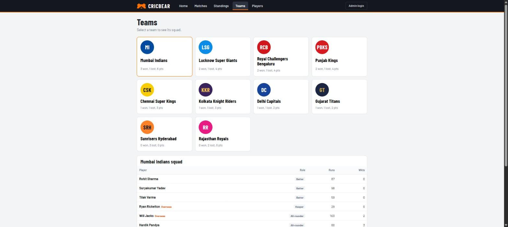
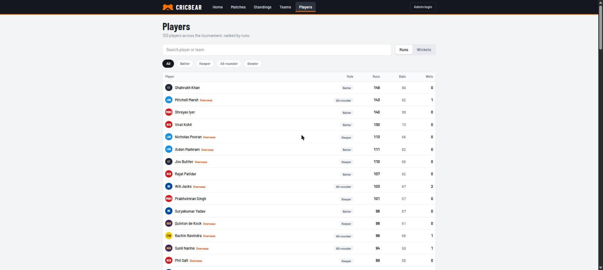
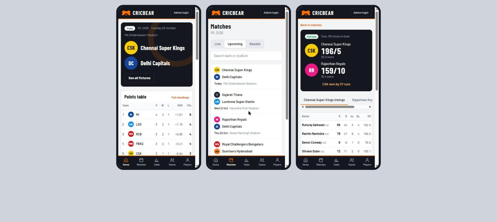
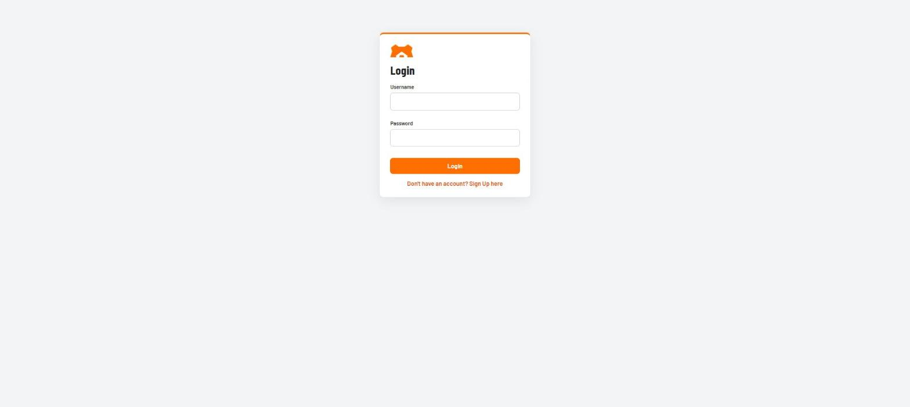
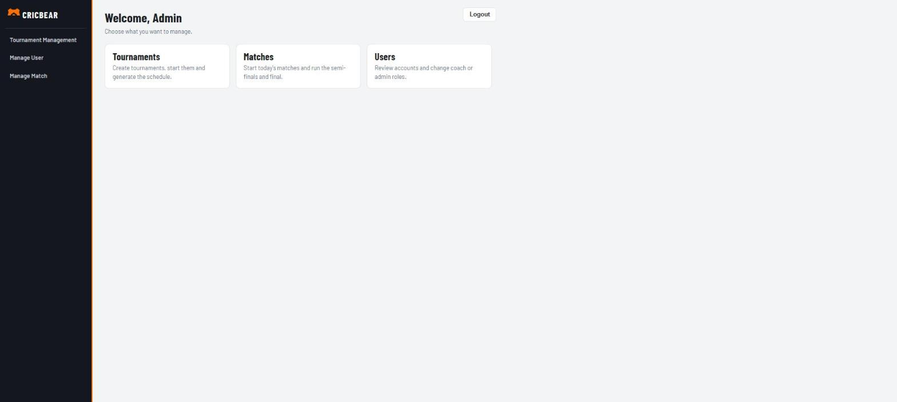
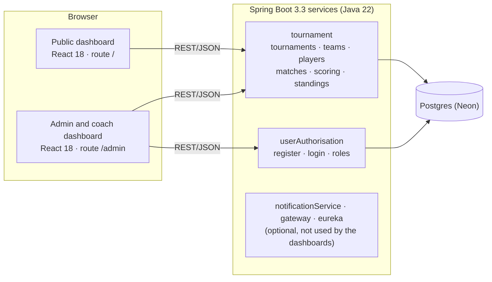

# CRICBEAR


Open-source cricket tournament management. Admins create tournaments and generate schedules, coaches register teams and players, and the public follows fixtures, scorecards and standings.

**Live demo:** https://cricbear.vercel.app · **Admin and coach login:** https://cricbear.vercel.app/admin

| Part | Docs |
|---|---|
| Frontend (two React apps) | [CRICBEAR_Frontend/README.md](CRICBEAR_Frontend/README.md) |
| Backend (Spring Boot services, data model, API) | [CRICBEAR_Backend/README.md](CRICBEAR_Backend/README.md) |
| Notes for AI coding agents | [SKILL.md](SKILL.md) |

## Screenshots


*Home: the next or live match, the points table, latest results and upcoming fixtures.*


*Match centre: scoreboard, result line, and batting and bowling scorecards for each innings.*


*Matches: live, upcoming and finished matches with search by team or stadium.*


*Standings: one table per group; the top two teams in each group are marked as qualifying.*


*Teams: pick a franchise to see its squad, roles and overseas players.*


*Players: leaderboard by runs or wickets, filterable by role.*


*Mobile: every page is responsive; navigation moves to a bottom tab bar on phones.*


*Admin and coach sign-in.*


*Admin dashboard: shortcuts to tournaments, matches and user roles.*

## Architecture



- Both dashboards are static React builds served from one site: the public app at `/` and the admin and coach app under `/admin`.
- They call the auth and tournament services directly over REST. There is no server-side session; the admin app keeps the signed-in user in the browser.
- Each service is layered as `controller` → `service` → `repository` → `model` (Spring Data JPA on Postgres).
- The data model, enumerations, match lifecycle and REST API are documented in the [backend README](CRICBEAR_Backend/README.md); the design system, routes and configuration are in the [frontend README](CRICBEAR_Frontend/README.md).

## Repository layout

```
CRICBEAR/
├── CRICBEAR_Backend/    Spring Boot services + DB_SETUP/schema.sql
├── CRICBEAR_Frontend/   dashboardforpublicuser, dashboardforadmincoach, brand assets, docs/screenshots
├── SKILL.md             guide for AI coding agents
└── LICENSE              Apache-2.0
```

## Run locally

Prerequisites: JDK 22+, Maven, Node 18+, and a Postgres database (a free [Neon](https://neon.com) project works).

```bash
psql "$POSTGRES_URL" -f CRICBEAR_Backend/DB_SETUP/schema.sql

export DATABASE_URL='jdbc:postgresql://<host>/<db>?sslmode=require'
export DATABASE_USER='<user>' DATABASE_PASSWORD='<password>'
(cd CRICBEAR_Backend/userAuthorisation && mvn spring-boot:run)   # :8083
(cd CRICBEAR_Backend/tournament        && mvn spring-boot:run)   # :8084

(cd CRICBEAR_Frontend/dashboardforadmincoach && npm install && PORT=3000 npm start)
(cd CRICBEAR_Frontend/dashboardforpublicuser && npm install && PORT=3001 npm start)
```

## Known limitations

- Registration is open; promote the first admin in the database: `update users set role='ADMIN' where username='…';`
- `SecurityConfig` permits all requests, so authorization is enforced by the dashboards only. Harden the API before storing real data.

## Contributing

Issues and pull requests are welcome. Fork, branch, keep changes focused, and make sure `npm test` and `mvn test` pass. Contributions are released under [Apache-2.0](LICENSE).
