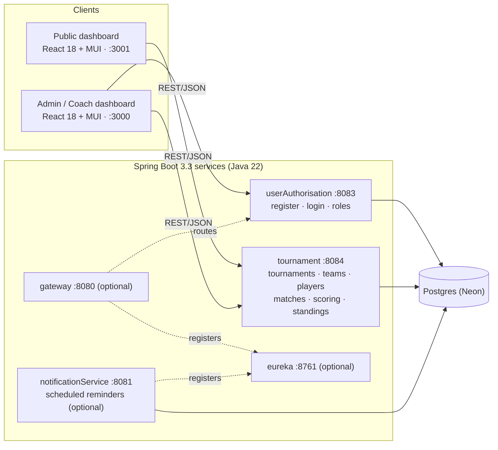
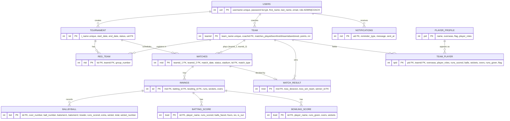

# CRICBEAR 🏏

Open-source cricket tournament management. Admins create tournaments and generate schedules, coaches register teams and players, and the public follows matches, scores and standings.

License: [Apache-2.0](LICENSE) · Frontend docs: [CRICBEAR_Frontend](CRICBEAR_Frontend/README.md) · Backend docs: [CRICBEAR_Backend](CRICBEAR_Backend/README.md) · Agent guide: [SKILL.md](SKILL.md)

## Complete architecture



| Component | Tech | Path | Port |
|---|---|---|---|
| Public dashboard | React 18, MUI, axios | `CRICBEAR_Frontend/dashboardforpublicuser` | 3001 |
| Admin/Coach dashboard | React 18, MUI, axios | `CRICBEAR_Frontend/dashboardforadmincoach` | 3000 |
| Auth service | Spring Boot, Spring Security, JPA | `CRICBEAR_Backend/userAuthorisation` | 8083 |
| Tournament service | Spring Boot, JPA | `CRICBEAR_Backend/tournament` | 8084 |
| Notification service | Spring Boot, JPA (optional) | `CRICBEAR_Backend/notificationService` | 8081 |
| Gateway / Eureka | Spring Cloud (optional) | `CRICBEAR_Backend/gateway`, `eureka` | 8080 / 8761 |
| Database | Postgres | `CRICBEAR_Backend/DB_SETUP/schema.sql` | 5432 |

**Request flow.** The dashboards call the auth and tournament services directly over REST; there is no server-side session. Login returns the user (and role), which the admin/coach dashboard keeps client-side to show role-specific screens. Eureka and the gateway are optional local conveniences and are not used by the dashboards.

**Layering (each service).** `controller` (REST, CORS) → `service` (business rules: scheduling, standings, role checks) → `repository` (Spring Data JPA) → `model` (JPA entities). Enums are stored as strings.

**Match lifecycle.** `UPCOMING` → admin starts the tournament (`POST /tournament/start`) → teams are split into groups and `/match/schedule/{tid}/{uid}` creates `NORMAL` matches → `/match/start/{mid}` sets `LIVE`, creates innings and ball-by-ball/batting/bowling scores → on completion a `match_result` is written and team points/NRR update → `/match/semi/{tid}/{uid}` and `/match/final/{tid}/{uid}` create `SEMIFINAL`/`FINAL` matches from the points table → tournament `COMPLETED`.

## Data model



Enumerations (stored as `VARCHAR`):

| Field | Values |
|---|---|
| `users.role` | `ADMIN`, `COACH` |
| `tournament.status`, `matches.status` | `LIVE`, `UPCOMING`, `COMPLETED` |
| `matches.match_type` | `NORMAL`, `SEMIFINAL`, `FINAL` |
| `ballbyball.extra` | `WIDE`, `NOBALL` |
| `ballbyball.wicket` | `CAUGHT`, `BOWLED`, `RUNOUT`, `LBW` |
| `match_result.toss_desicion` | `BAT`, `BOWL` |
| `*.player_roles` | `BATSMAN`, `BOWLER`, `WICKETKEEPER`, `ALLROUNDER` |

Delete rules: removing a user cascades to their tournaments, teams and notifications; removing a tournament sets `matches.tid` to null; removing a team cascades to its registrations, matches, innings and players. The column name `toss_desicion` (sic) matches the `MatchResult` entity.

## Roles

- **Admin:** create tournaments, manage users and roles, start a tournament (generates the schedule), start matches, run semi-finals and final.
- **Coach:** register, create/edit a team and players, register the team for a tournament.
- **Public:** read-only view of tournaments, teams, players, matches and standings.

## Run locally

Prerequisites: JDK 22+, Maven, Node 18+, a Postgres database (a free [Neon](https://neon.com) project works).

```bash
psql "$POSTGRES_URL" -f CRICBEAR_Backend/DB_SETUP/schema.sql

export DATABASE_URL='jdbc:postgresql://<host>/<db>?sslmode=require'
export DATABASE_USER='<user>' DATABASE_PASSWORD='<password>'
(cd CRICBEAR_Backend/userAuthorisation && mvn spring-boot:run)   # :8083
(cd CRICBEAR_Backend/tournament        && mvn spring-boot:run)   # :8084

(cd CRICBEAR_Frontend/dashboardforadmincoach && npm install && PORT=3000 npm start)
(cd CRICBEAR_Frontend/dashboardforpublicuser && npm install && PORT=3001 npm start)
```

Details and configuration variables are in the [backend](CRICBEAR_Backend/README.md) and [frontend](CRICBEAR_Frontend/README.md) READMEs.

## Known limitations

- Registration is open; promote the first admin in the database: `update users set role='ADMIN' where username='…';`
- `SecurityConfig` permits all requests, so authorization is enforced by the dashboards only. Harden before storing real data.

## Contributing

Issues and pull requests are welcome. Fork, branch, keep changes focused, and make sure `npm test` / `mvn test` pass. Contributions are released under Apache-2.0.
